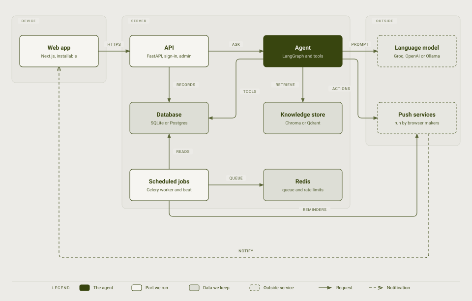
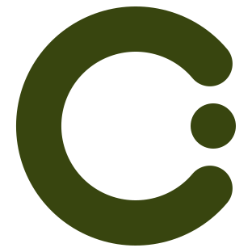

# Campus Copilot

AI that doesn't just answer. It acts.

## Why

Questions about a campus are answered in many places: handbooks, notices, portals, the office down the corridor. Some needs are not questions at all: registering for an event, booking a study room, reporting a fault. A plain chatbot is poor at both. It can invent an answer about a rule it has never read, and it cannot do anything.

Campus Copilot is an assistant built to avoid both problems. It answers from the college's own documents and shows which ones it used. It does exact work, such as counting attendance or checking free seats, with ordinary code. And when something would change a student's data, it proposes the change and waits for the student to say yes.

It is a learning project and a reference implementation of that design, with a fictional college as its sample data.

## Principles

- Each part has one job. A reader should be able to find where a question is answered.
- Ordinary code does the exact work. The model decides when to check attendance; Python does the sum.
- Campus facts come from retrieved documents, not from the model's memory.
- The student decides. The assistant proposes an action and nothing happens until it is approved.
- Keep the infrastructure small. The core needs no separate vector database server and no extra services.

## Architecture

## Status

What works today: a chat grounded in campus documents, with sources; tools for timetables, exams, fees, attendance, the library, study rooms, the canteen and more; ten actions that wait for the student's approval; an admin dashboard for events, students, documents, grievances and usage; an installable web app that can be read offline; push notifications; a calendar file of registered events; and scheduled event reminders and attendance warnings. It has rate limits, a prompt injection screen, HTTPS in production, structured logs, metrics and tracing, a test suite, and continuous checks on every push.

Decided against building: single sign-on, email notifications, voice and image input, an Android app, sign-in with Google Calendar, and an answer cache.

Deferred: support for several colleges at once, and research-grade extras (answers that check themselves, a knowledge graph, thumbs up and down on replies, and explanations of why the assistant said something).

Known limits. The college, its documents and its students are fictional. Exam schedule updates are not sent as notifications, because the app has no way to change the exam schedule. Chroma's separate server mode has known security advisories with no fix yet, so it must never be exposed to a network; the default setup does not use it. The project has not had a professional security review.

## Documentation

- [Getting started](docs/getting-started.md): run it on your machine, then deploy it.
- [Architecture](docs/architecture.md): how the parts fit together, with diagrams.
- [Glossary](docs/glossary.md): every technical term in plain words.
- [Backend](backend/README.md): the API, the agent, retrieval, security and settings.
- [Frontend](frontend/README.md): the screens, the design system and offline behaviour.
- [Data](data/README.md): the fictional sample data and how it is loaded.
- [Knowledge](knowledge/README.md): the fictional campus documents the assistant reads.
- [Brand](assets/brand/brand.md): the mark, colours and typeface.
- [Roadmap](TODO.md): what is done, dropped and deferred.

## Contributing

Contributions are welcome. [CONTRIBUTING.md](CONTRIBUTING.md) says what a good contribution looks like, where things live, and how to submit a change.

## Licence

MIT. See [LICENSE](LICENSE).

 

AI that doesn't just answer. It acts.

