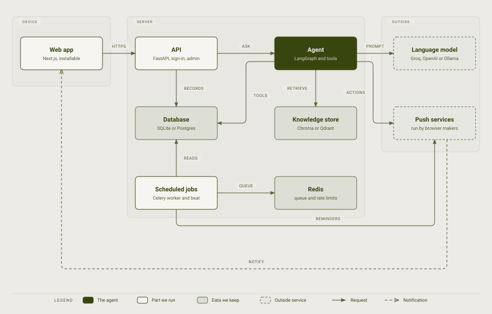
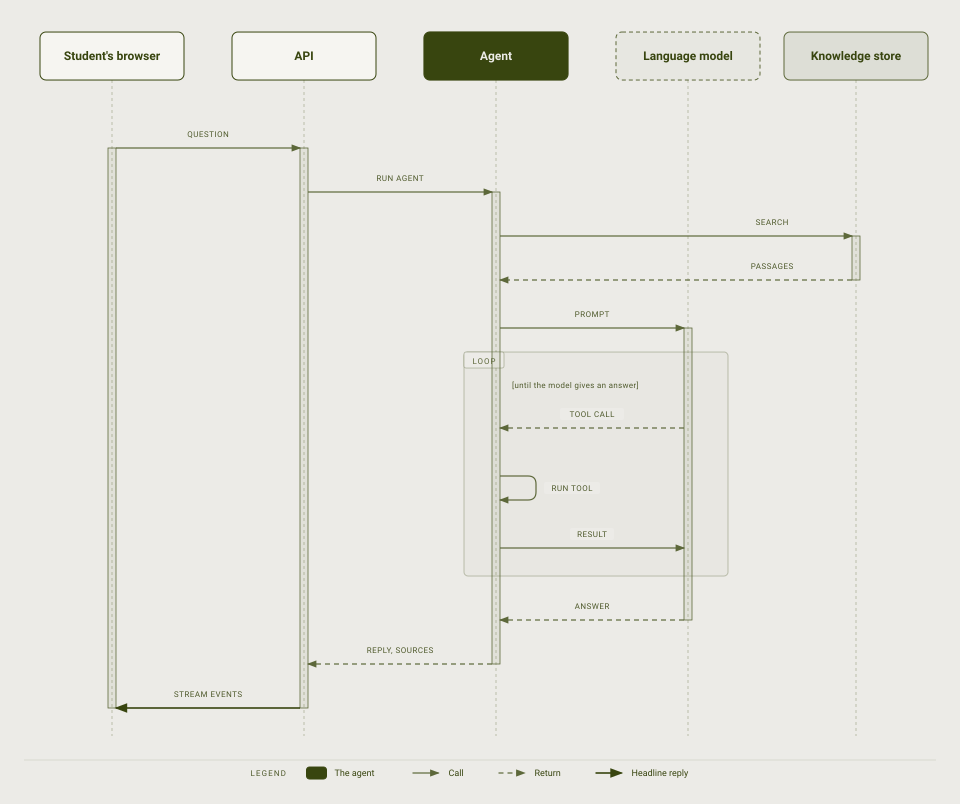
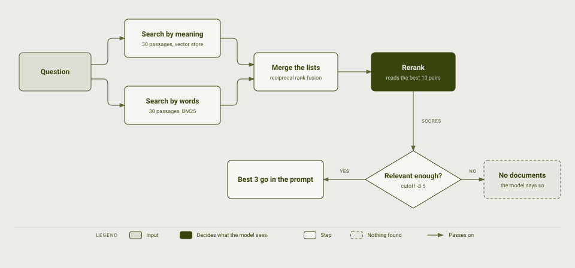
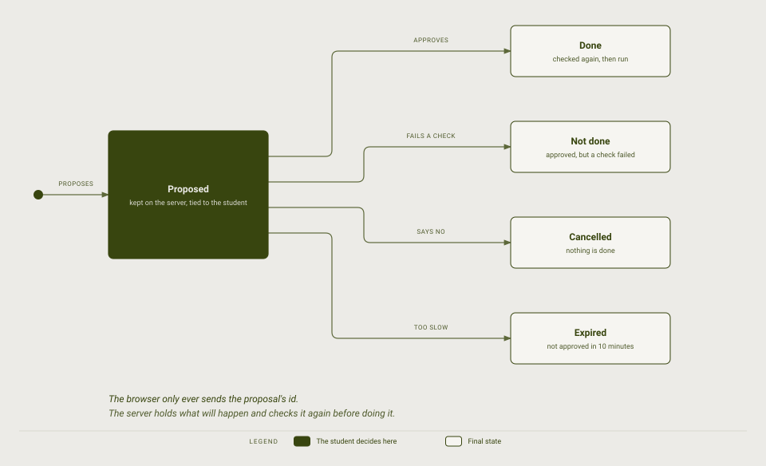

# Architecture

How the parts of Campus Copilot fit together, and why.

Terms in *italics* are defined in the [glossary](glossary.md).

## The parts

A student uses a web app. It talks to an API, which hands questions to an agent. The agent can look up campus documents, read and change campus data, and ask a language model to put the answer into words. Background jobs and the agent also send notifications back to the student's device.

- **Web app.** A Next.js site with the chat, an events browser, a profile page and an admin dashboard. It can be installed like an app, and the events, the signed-in identity and the last conversation can be read without a connection. What is kept for offline use is cleared when the student signs out.
- **API.** A FastAPI service. It signs people in, keeps their session in cookies, applies *rate limits*, screens chat messages for *prompt injection*, and serves the chat, events, profile and admin endpoints.
- **Agent.** The part that decides what to do for a question. It is a *LangGraph* graph: retrieve passages, let the model reason, run any tools it asks for, and respond. It is described step by step below.
- **Database.** Students, events, registrations, academic records, library, grievances and so on. SQLite for local use and PostgreSQL in production; the schema changes through *migrations*.
- **Knowledge store.** The campus documents, cut into chunks and stored as *embeddings*. *Chroma* by default, inside the backend process; *Qdrant* as an option.
- **Language model.** A hosted model, *Groq* by default. OpenAI and Ollama can be used instead.
- **Scheduled jobs.** *Celery* sends the event reminders every morning at 08:00 and the attendance warnings on Mondays at 09:00, in Asia/Kolkata time. *Redis* holds the job queue.
- **Push services.** The browser makers' own services, which deliver notifications to a device even when the app is closed.

## How a chat question is answered

1. The browser sends the question to the API. The message is cleaned, screened, and counted against the student's rate limit before anything else happens.
2. The API runs the agent with the last 40 messages of the conversation.
3. The agent first searches the knowledge store. This happens on every question, before the model is involved. How it works is in the next section.
4. The agent sends the question, the passages and the list of tools it may use to the language model.
5. The model either answers or asks for a tool, such as "check my attendance". The agent runs the tool in ordinary Python code, with the signed-in student's identity, and gives the result back. The model never runs anything itself, and never chooses whose data a tool reads. This repeats for at most four rounds.
6. The reply streams back as it is written, together with which tools ran and which documents were used, so the student can see where an answer came from.

If the knowledge store cannot be reached, the agent answers without documents instead of failing the whole question.

## How the right passages are found

No single search is good enough. A search by meaning finds "when does the library shut" for a passage about opening hours, but can miss an exact room number. A search by words does the opposite. So the question is searched both ways, each returning 30 passages, and the two lists are merged with *reciprocal rank fusion*.

The best ten of the merged list are then read, together with the question, by a *cross-encoder*, which scores each pair far more carefully than the first searches could. Passages scoring below the cutoff (`-8.5` by default, set by `RAG_RERANK_MIN_SCORE`) are dropped and at most three are kept (`RAG_TOP_K`). If none clear the cutoff, the model is told there are no documents and says so, which is better than answering from a weak match.

The documents themselves are plain Markdown files in `knowledge/`. The ingest command cuts them into chunks, turns each chunk into an embedding, and stores both in the knowledge store.

## Actions need a yes

Reading data is safe, so the agent does it freely. Changing data is not. Ten actions can change something for a student: registering for an event, cancelling a registration, joining a waitlist, giving event feedback, reserving a library book, booking a study room, booking a counselling appointment, reporting a maintenance issue, reporting a lost item and raising a grievance.

When the model asks for one of them, nothing happens. The server saves a *proposal* tied to the signed-in student and returns a confirmation card showing what would happen. The student can confirm or cancel. The browser sends back only the proposal's id, never the details, so a page cannot be tampered with to do something different.

On approval the server checks everything again, because time has passed: are seats still free, is the student already registered. If the checks pass, the action runs. If one fails, the student is told why and nothing is done. A proposal that is not answered within ten minutes expires.

## Notifications and background jobs

A student can allow *push notifications* in their browser from the profile page. They are then told when:

- a registration is confirmed;
- a waitlist seat opens for them, because someone cancelled or an admin raised the capacity;
- a new event is created in a category they said they like;
- an event they registered for starts within the next 24 hours (the morning job);
- their attendance is below 75% in a course (the weekly job).

Push is off until a key pair is set (`make vapid-keys`; see [getting started](getting-started.md)). The server sends a request to whatever address a browser registers, so it accepts only the known browser push services, both when the address is saved and again when sending. Anything else is refused.

Exam schedule updates are not sent, because the app has no way to change the exam schedule.

## Design choices

- **Keep it understandable.** Each concern has one place: screens, orchestration, retrieval, tools and data are separate. Someone reading the code should be able to find where a question is answered.
- **Use plain code for exact work.** Attendance percentages, seat counts and dates are calculated in Python, not guessed by the model.
- **Ground answers in documents.** Answers about campus rules come from retrieved passages, with the sources shown.
- **Keep actions under the student's control.** The agent proposes; the student decides.
- **Keep the infrastructure small.** Chroma runs inside the backend, and the database is a single SQLite file until a deployment needs PostgreSQL. Redis and the Celery services are needed only for the scheduled jobs, and the rate limits use Redis only when it is configured.

## Known limit: running Chroma as a separate server

The optional `chroma-server` profile runs Chroma as its own server. Known security advisories for Chroma's server mode have no fixed release yet. It listens on localhost only and is off by default. The default setup runs Chroma inside the backend and opens no Chroma port at all. Do not expose a Chroma server to a network; use the embedded mode or Qdrant instead.
